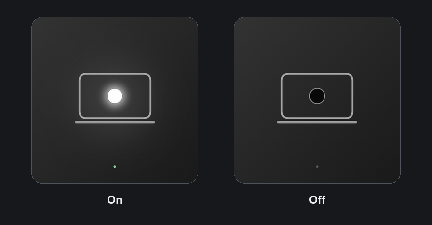

# Lid Switch

Lid Switch turns the illuminated Apple logo on your MacBook Pro on or off with a click in the menu bar. The window and Dock icon show your setting while the app is running. Turn the light on and macOS adjusts its brightness with the screen and the ambient light.



## Install

The first signed download is pending. [Install from source](#build-from-source) to use Lid Switch now.

## Which Macs work?

You need an Apple silicon MacBook Pro with a built-in **PROLED XDR** display and an illuminated lid logo. The app requires macOS 14 or later. [Apple’s hardware and illumination guide](https://support.apple.com/en-us/149248)

## Using the switch

On your first click, macOS asks for administrator approval to install the helper. After setup, you can switch the light from the window or the menu bar.

- A solid dot in the menu bar means on. A hollow dot means off. A question mark means the app can’t read the setting. Click it for setup or recovery. If the stored value is unrecognized, choose **Turn On** or **Turn Off**.
- Close the window to keep using the menu bar. Right-click the menu bar icon to reopen the window or quit. The light keeps its setting after you quit or restart your Mac. Reopen Lid Switch when you want the controls again.
- The setting applies to every account on the Mac. The helper accepts requests from the account that set it up. Your password goes directly to macOS. The app works offline and has no analytics.

## Remove

Open the app window and choose **Lid Switch → Remove Background Control…**. Approve removal, quit the app, then move it to the Trash. To leave the logo in its usual automatic mode, turn it on before removing the helper.

## Build from source

Install Apple’s Command Line Tools for Xcode. Run the following command from the source directory.

```sh
zsh build.sh --install
```

Open **Lid Switch** in your home folder’s **Applications** directory. The command prints the installed path. The source includes the app, helper, installer and icon artwork. [Release and test instructions](RELEASING.md) · [MIT license](LICENSE)
